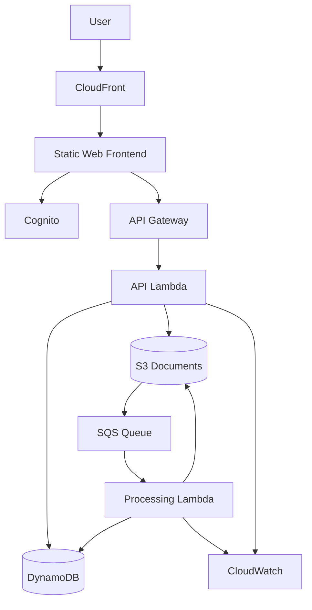

# CloudVault

> An AWS Solutions Architect Associate learning project built incrementally as I progress through the SAA course.

## Project goal

CloudVault is a secure, scalable, and cost-conscious document platform. I am using it to turn AWS concepts from the Solutions Architect Associate course into hands-on architecture decisions and implementation work.

**Learning loop:** Learn → Build → Break → Troubleshoot → Document → Improve

## Current status

### Phase 0 — IAM & Account Foundations

**Status: ✅ Complete**

- [x] Create the GitHub repository
- [x] Configure a $10/month AWS Budget
- [x] Secure the AWS root user and everyday access
- [x] Configure AWS CLI with temporary credentials
- [x] Verify identity with `aws sts get-caller-identity`
- [x] Create `CloudVaultEC2Role`
- [x] Validate its EC2 trust relationship
- [x] Document Phase 0 lessons

### Phase 1 — Amazon S3 / Object Storage

**Status: ✅ Complete**

- [x] Create the CloudVault document bucket
- [x] Use `ap-southeast-1`
- [x] Configure `BucketOwnerEnforced`
- [x] Enable all S3 Block Public Access controls
- [x] Enable bucket versioning
- [x] Configure SSE-S3 (`AES256`)
- [x] Add CloudVault resource tags
- [x] Upload and download objects through the AWS CLI
- [x] Test object versioning
- [x] Test delete markers and recovery
- [x] Test restoring an older object version
- [x] Finalize the least-privilege S3 IAM policy
- [x] Validate the policy with IAM Access Analyzer
- [x] Create `CloudVaultS3DocumentAccess`
- [x] Attach the policy to `CloudVaultEC2Role`
- [x] Validate allowed and denied actions with the IAM policy simulator
- [x] Configure S3 lifecycle management
- [x] Configure 30-day expiration for noncurrent object versions
- [x] Review S3 storage classes
- [x] Test presigned URLs for temporary private access
- [x] Test direct upload with a presigned PUT URL
- [x] Test S3 user-defined object metadata
- [x] Validate metadata behavior with object versioning
- [x] Review CloudWatch S3 storage metrics
- [x] Review CloudTrail management-event visibility
- [x] Validate final bucket security configuration
- [x] Validate final IAM role and policy configuration
- [x] Review Phase 1 storage usage and AWS cost
- [x] Complete Phase 1 validation and documentation

### Phase 2 — Amazon EC2 / Compute

**Status: 🟡 In progress — EC2, S3 integration, and EBS recovery labs verified; final cost review and documentation checkpoint pending**

- [x] Launch `CloudVaultEC2Dev01` in `ap-southeast-1` using Amazon Linux 2023 (`t3.micro`, x86_64)
- [x] Use the default VPC and a public subnet for the temporary compute lab; defer custom networking to Phase 3
- [x] Configure `CloudVaultEC2SecurityGroup` with no inbound rules and outbound access
- [x] Use Systems Manager Session Manager instead of SSH; do not create an SSH key pair
- [x] Create `CloudVaultEC2InstanceProfile` and associate `CloudVaultEC2Role`
- [x] Attach `AmazonSSMManagedInstanceCore` alongside the scoped `CloudVaultS3DocumentAccess` policy
- [x] Configure an encrypted 8 GiB gp3 EBS root volume with deletion on instance termination
- [x] Require IMDSv2 and verify instance metadata access using a session token
- [x] Keep detailed monitoring disabled and enable termination protection
- [x] Connect through Session Manager and verify the operating system, storage, SSM agent, and IAM role credentials
- [x] Verify allowed S3 list, upload, download, and delete operations from the EC2 instance
- [x] Verify access to the `private/` prefix is denied
- [x] Confirm that deleting a current object in the versioned bucket creates a delete marker and retains its previous version
- [x] Confirm a version-specific deletion attempt is denied (the error reported missing `s3:ListBucketVersions`)
- [x] Practice stopping and restarting the instance for cost control
- [x] Create and attach a separate encrypted 1 GiB gp3 EBS data volume in the same Availability Zone
- [x] Identify the new NVMe device, create an XFS filesystem, and mount it at `/data/cloudvault` without modifying the root filesystem
- [x] Configure a persistent UUID-based `/etc/fstab` mount with `nofail` and verify data survives an EC2 stop/start cycle
- [x] Create an encrypted EBS snapshot and restore it to a separate 1 GiB volume
- [x] Mount the restored XFS filesystem read-only using `ro,nouuid,norecovery` to handle the duplicate filesystem UUID
- [x] Compare original and recovered test files to verify data integrity
- [x] Unmount, detach, and delete the temporary restored volume; delete the temporary snapshot
- [x] Stop the EC2 instance and verify the retained root and data volumes
- [ ] Review actual Phase 2 billing and remaining resources against the budget
- [ ] Complete the Phase 2 documentation checkpoint and decide whether to cover EC2 user data as an additional exercise

## Current implementation

CloudVault currently has a private S3 document-storage foundation with:

- S3 Block Public Access fully enabled
- `BucketOwnerEnforced` object ownership
- SSE-S3 encryption
- object versioning and recovery
- 30-day expiration of noncurrent versions
- least-privilege access to the `documents/` prefix through `CloudVaultEC2Role`
- presigned GET and PUT workflows
- baseline CloudWatch and CloudTrail observability

The Phase 2 compute lab now adds:

- an Amazon Linux 2023 `t3.micro` EC2 instance in `ap-southeast-1`, using the default VPC temporarily
- an encrypted 8 GiB gp3 EBS root volume, IMDSv2 required, and termination protection enabled
- a security group with no inbound rules and access through AWS Systems Manager Session Manager (no SSH key pair)
- an EC2 instance profile that supplies temporary IAM role credentials without static access keys
- successful EC2-to-S3 list, upload, download, and delete tests, plus expected authorization-denial tests
- verification that a normal S3 delete creates a delete marker while retaining the previous object version
- a separate encrypted 1 GiB gp3 EBS data volume in the instance's Availability Zone, formatted as XFS and mounted persistently at `/data/cloudvault` using its filesystem UUID
- a completed snapshot-and-restore exercise, including a read-only mount of the restored XFS volume and successful file-integrity comparison
- verified cleanup of the temporary restored EBS volume and snapshot

**Verified state as of 2026-10-12:** `CloudVaultEC2Dev01` is **stopped**. Its encrypted 8 GiB root EBS volume and original encrypted 1 GiB data EBS volume remain attached (9 GiB total provisioned EBS storage). The temporary restored volume and recovery snapshot have been deleted. This is a temporary learning environment; the planned application architecture below is not yet deployed.

For implementation details and verified outcomes, see the [Phase 2 EC2 and EBS learning log](docs/learning-log/phase-2-ec2.md) and [current-state Mermaid diagram](docs/architecture/cloudvault-current-state.mmd).

## Budget guardrail

**Target steady-state cost:** less than **$10 USD/month**

The project will prefer serverless and pay-per-use services for the final architecture. More expensive always-on resources such as NAT Gateways, load balancers, EC2 fleets, and RDS deployments will be treated as temporary learning labs unless they can be justified within the budget.

Phase 1 cost validation confirmed that the S3 learning workload remained effectively at $0 at its current lab scale and comfortably within the project budget. Current-period Cost Explorer figures are estimates until billing data is finalized.

At the 2026-10-12 checkpoint, the EC2 instance was verified **stopped** to avoid further instance compute charges while idle. The retained 8 GiB root and 1 GiB data EBS volumes continue to incur storage charges even while the instance is stopped. The temporary restored EBS volume and snapshot were deleted after validation. Public IPv4 addresses and other provisioned resources may have separate charges depending on their configuration and state. Review actual usage in Billing/Cost Explorer and AWS Budgets; no precise Phase 2 billed amount has been verified yet.

## Planned architecture



The target architecture will evolve as each AWS service is covered in the course. A separate current-state diagram records only what has actually been implemented so far.

## Roadmap

| Phase | Focus | AWS concepts/services |
|---|---|---|
| 0 | Security foundation | IAM, MFA, roles, policies, AWS CLI, STS |
| 1 | Object storage | S3, encryption, versioning, metadata, lifecycle, storage classes, presigned URLs, monitoring |
| 2 | Compute | EC2, EBS, user data, instance roles |
| 3 | Networking & HA | VPC, subnets, routing, security groups, ELB, Auto Scaling |
| 4 | Databases | RDS, backups, Multi-AZ concepts, DynamoDB |
| 5 | Serverless API | Lambda, API Gateway, DynamoDB |
| 6 | Asynchronous processing | S3 events, SQS, Lambda, DLQ |
| 7 | Delivery & observability | CloudFront, Cognito, CloudWatch |
| 8 | Final review | Well-Architected tradeoffs, cost optimization, documentation |

## Repository structure

```text
aws-cloudvault/
├── README.md
├── PHASE-0-SETUP.md
├── budget/
│   ├── budget.json
│   └── notifications.json
├── docs/
│   ├── architecture/
│   │   ├── cloudvault-architecture.mmd
│   │   └── cloudvault-current-state.mmd
│   ├── learning-log/
│   │   ├── phase-0-iam.md
│   │   ├── phase-1-s3.md
│   │   └── phase-2-ec2.md
│   └── reference/
│       └── CloudVault_Command_Notes.xlsx
├── iam/
│   ├── assume-role-policy-ec2.json
│   └── policies/
│       └── cloudvault-s3-document-access.json
├── s3/
│   └── config/
│       ├── bucket-encryption.json
│       ├── bucket-tags.json
│       └── lifecycle.json
├── scripts/
│   └── presigned_put.py
├── backend/
├── frontend/
└── infrastructure/
```

## Security principles

- Do not use the AWS root user for everyday work.
- Protect root and other privileged access with MFA.
- Prefer temporary credentials over long-lived access keys.
- Grant least privilege and scope resource access wherever possible.
- Keep IAM trust relationships separate from workload permissions and validate both independently.
- Keep S3 document storage private by default.
- Use short-lived presigned URLs when temporary access to private S3 objects is required.
- Treat active presigned URLs as sensitive and never commit them to source control.
- Never commit secrets, access keys, tokens, `.env` files, or AWS credential files.
- Avoid publishing unnecessary account IDs, account-specific ARNs, role IDs, canonical owner IDs, and object version IDs.

## Cost principles

- Create a monthly AWS Budget before deploying project resources.
- Tag project resources where practical.
- Shut down or delete lab resources after use.
- Review Billing/Cost Explorer regularly.
- Keep CloudWatch log retention deliberate rather than unlimited by default.
- Use lifecycle management where it improves long-term storage hygiene without adding unnecessary complexity.
- Enable additional monitoring or audit features when their operational or security value justifies their cost and complexity.

## Identity verification

Before performing project operations, verify the active AWS identity:

```powershell
aws sts get-caller-identity --profile cloudvault
```

Expected shape:

```json
{
  "UserId": "...",
  "Account": "123456789012",
  "Arn": "arn:aws:..."
}
```

Do not publish your AWS account ID or credentials in screenshots.

## Disclaimer

This is a learning project. The architecture will intentionally change as I explore AWS design tradeoffs and apply new services from the SAA curriculum.
